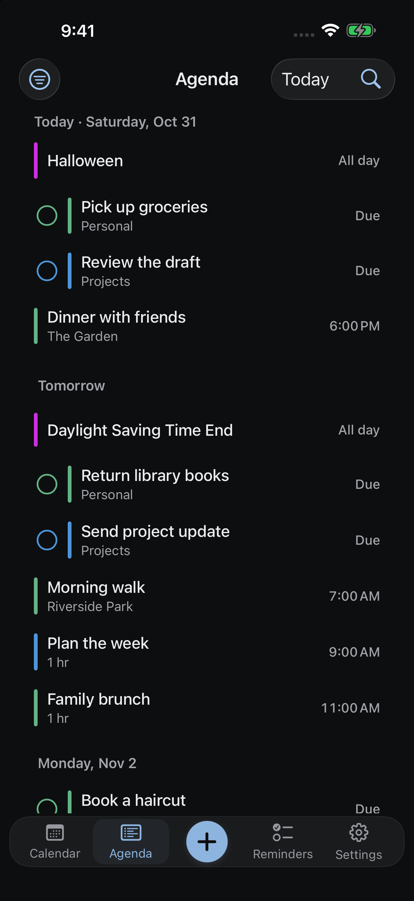
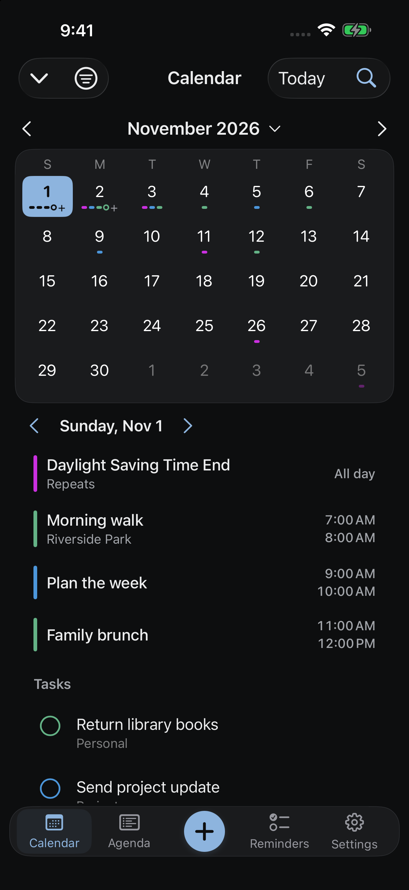
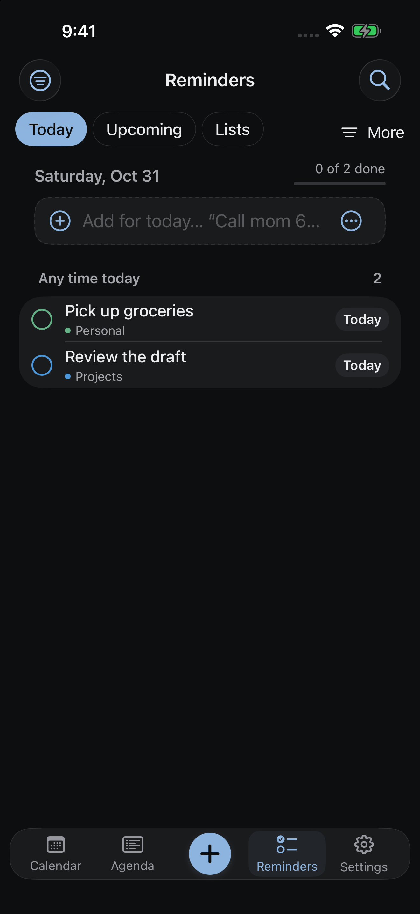

# LotsOfEvents

> **Development disclosure:** AI was used to develop this app.

Native SwiftUI iPhone/iPad agenda and WidgetKit extension. Requires iOS 18+ and Xcode 26+ (Swift 6 language mode; built with Xcode 27).

## App screenshots

iPhone screenshots with sample data. Select an image to view it full size.

[Support and how-to guide](https://walt11.github.io/LotsOfEvents/) · [Privacy policy](https://walt11.github.io/LotsOfEvents/privacy.html)

## Run

1. Open `LotsOfEvents.xcodeproj`, select the LotsOfEvents scheme and an iPhone simulator or device.
2. For a physical device, select your development team for both targets. Use unique bundle identifiers and register an App Group. Set the `APP_GROUP` build setting to that group for both targets; it drives entitlements and shared preferences.
3. Run the app, connect calendars, then open Sources to connect Reminders and select lists.
4. Add the Upcoming Agenda widget through the Home Screen widget gallery.

`project.yml` is the source of project configuration. Regenerate with `xcodegen generate` after changing it. No third-party runtime dependencies or server.

## Behavior

- Shows today (including earlier events) plus four more days by default; configurable from 2–14 days total.
- Includes events overlapping the range, and incomplete reminders with due dates inside it. Undated and earlier overdue reminders are excluded.
- Calendars default to selected, including calendars added later (hidden calendars are stored as exclusions); reminder lists are opt-in. Empty selection means no items of that type.
- Multi-day events appear under every day they cover in Upcoming and the widgets; later days show “All day” or “Until <end time>”.
- Widgets offer seven selectable darker matte themes (Graphite, Slate, Sage, Sand, Clay, Lavender, Black). Black stays black; the others have light/dark variants, in Sources → Widget theme. The selection is shared with all widgets. Widgets group items under date headings on a flat themed background, with colored calendar bars and single-line items. Item notes and date subtitles are hidden in the widget. All-day items have no time label; timed events show their start–end time beneath the title, and timed reminders show their due time. Pages adapt to the space needed by headings and notes. Arrow buttons change pages without opening the app. The + deep link opens Apple’s native event editor; the widget background opens the full agenda.
- The native event editor supports calendars, all-day events, repeat rules, alerts, and locations.
- Widget queries EventKit on refresh and reads selections through the App Group. It requests a refresh every 15 minutes or at midnight, with actual timing controlled by iOS. The app also requests reloads after source changes, event changes, and foregrounding.
- Calendar and reminder data stays on device. The app does not upload it.

## Validation

Thirty-three tests cover date windows across daylight saving time, calendar-selection migration, multi-day expansion, day-view column layout, Quick Add parsing, priorities, and widget logic. One test completes a repeating reminder in the simulator’s Reminders store and is skipped unless Reminders access is granted (`xcrun simctl privacy booted grant reminders com.walt.LotsOfEvents`). Run the LotsOfEvents scheme’s tests in Xcode.

Device acceptance checks: grant/deny each permission independently; select and deselect all sources; create and cancel an event; verify all-day/multi-day events and dated reminders; add all widget sizes, exercise page arrows and +, and check refresh after editing in Apple Calendar/Reminders. Verify small-widget tap routing and App Group provisioning on your signed physical device before distribution.

## Calendar and Reminders app

The app has three tabs:

- **Calendar:** month grid with event indicators and selected-day agenda; a seven-day week agenda; a day schedule with hourly add shortcuts; and a 30-day agenda. Navigate backward/forward, jump to a date, or return to Today. Search titles, locations, and notes within one year before/after the selected date. Calendar source switches apply to these views and the widget.
- **Upcoming:** the existing combined calendar/reminder agenda, using the widget date range and selected reminder lists. Tap an item to view/edit it.
- **Reminders:** Today (including overdue), Scheduled, All incomplete, and Completed smart views; browse any list, search titles/notes, and sort by due date or priority. This tab shows all accessible lists, independently of widget selections. Complete/reopen with the circle or swipe action.

Tap an event for Apple's native detail screen and Edit for supported changes/deletion, including recurring-event handling. The + button creates an event on the browsed date. The native editor handles calendar, repeat, alert, location, and notes fields.

Reminder editing includes title, notes, website URL, list moves, date-only/timed due dates, priority, completion, daily/weekly/monthly/yearly repeats, and time-based alerts. Existing complex repeats and alarms are preserved with Keep existing; changing due date shifts absolute alerts by the same interval. Removing the due date also removes repeats/alerts. Deletion requires confirmation and affects synced Apple Reminders data. Read-only lists cannot be changed.

**Also included:** a timeline Day view (duration-sized blocks, side-by-side overlaps, current-time line, tap an hour to add); Quick Add (Upcoming → text-plus button, or `lotsofevents://quick-add`) that turns “Lunch Friday 1pm” into an event or reminder; Undo for completing, reopening, and deleting reminders (deleted reminders are recreated with a new identifier); Siri/Shortcuts actions “What’s Next” and “Add Reminder”; and new events default to the next half hour. Completed reminders load only while the Completed view or “Show completed” is open.

This core release does not implement reminder subtasks, tags, attachments, shared-list collaboration, list/calendar creation or deletion, invitation management, or drag-and-drop scheduling. These require further work; some Apple Reminders features are not exposed by EventKit.

Validation: twenty-one simulator tests cover date windows, DST, month grids, midnight end boundaries, multi-day/zero-duration events, date-only/timed reminder components, stable theme identifiers, preservation of repeat rules, alarm offsets, and location alerts, plus widget pagination, time subtitles, and selected-day overlap filtering. Signed device build/install is verified separately. Live account synchronization and every edit flow still need device acceptance testing with your accounts.

## Three-Day Agenda widget

A second gallery option, **Three-Day Agenda**, displays today and the next two dates as tappable tabs. The selected day shows its events and selected reminders, including multi-day events that overlap it. Timed items show times beneath the title; all-day items have no subtitle. Busy days have independent page controls. It uses the same theme and source selections as Upcoming Agenda, but always loads three days regardless of the Upcoming date-range setting. Date/page selection is shared between instances of this widget. When a saved day leaves the three-day range, selection returns to today.

The original Upcoming Agenda widget keeps its existing gallery identity and layout. Add the new option through Home Screen → Edit → Add Widget → LotsOfEvents → Three-Day Agenda.

## Additional small widgets

All five options use the existing theme and selected sources. The original Upcoming Agenda and Three-Day Agenda remain available. Free Time is not included.

- **Next Up:** ongoing/next timed calendar event within 14 days, plus the following event. All-day entries and reminders are excluded. Local timeline entries switch at event starts/ends; iOS controls refresh scheduling.
- **Events + Tasks:** today's calendar events and selected incomplete reminders that are due today, overdue, or undated. Tap a reminder circle to complete it. Page controls expose overflow in both sections.
- **Five-Day Strip:** today plus four days, with interactive date selection and pagination for the selected day.
- **Month + Agenda:** the current month's date grid, event/reminder dots, and selected-day agenda. Date selection and page controls are interactive. Uses the device's first weekday.
- **Focus List:** all incomplete reminders from selected lists, including overdue, future, and undated items. Orders by due date, then priority. Complete tasks directly, add a reminder with +, or tap the background to open Reminders in the app.

These five layouts support the small widget size. Selections and page positions are independent across layouts but shared among instances of the same layout. Reminder completion writes to Apple Reminders, honors read-only lists, and refreshes all widgets. The UI never completes sample gallery reminders. Live reminder completion and account synchronization should be checked on-device.

## Widget options and Lock Screen

Every widget can be edited (touch and hold → Edit Widget) to pick its own theme and limit it to specific calendars and reminder lists; leaving Calendars and Lists empty follows the app’s Sources screen. Next Up is also available as Lock Screen inline, circular, and rectangular widgets. Day tabs and highlights use the selected theme’s accent color.

## Quick Add without opening the app

Add **Add Event** or **Add Reminder** from Control Center (or as a Lock Screen control, or on the Action button). Tapping it shows a system prompt at the top of the screen; type a phrase like “Lunch Friday 1pm” and it is saved without opening the app. The same action is available to Siri and Shortcuts as “Quick add in LotsOfEvents”. A widget’s **+** opens the app directly into Quick Add with the keyboard up, since Home Screen widgets can’t show text input.

## Agenda and settings

The app opens to the Agenda tab, combining selected calendars and dated reminders into day sections. Tap the selected Agenda tab again to return to today. Calendar and Reminders retain their full editors and search. Settings groups calendar and reminder selections by account, shows selection counts, and provides a dedicated theme gallery with widget previews and a widget setup guide. Existing widget configurations, Siri actions, and quick-add controls are retained.

## Layout

On iPhone, the bottom bar holds Agenda, Calendar, Reminders, and Settings around a center **+**: tap it for Quick Add, or touch and hold for the full event or reminder editor. Quick Add offers one-tap day and time shortcuts and lets you pick the calendar or list. On iPad, a sidebar replaces the bottom bar. Calendar's Week view is a seven-column timeline (tap a day header to open it, or an empty slot to add an event); the month grid shows colored bars for busy days. Agenda rows show an event's location or duration, and reminder rows can be completed or snoozed in place.
